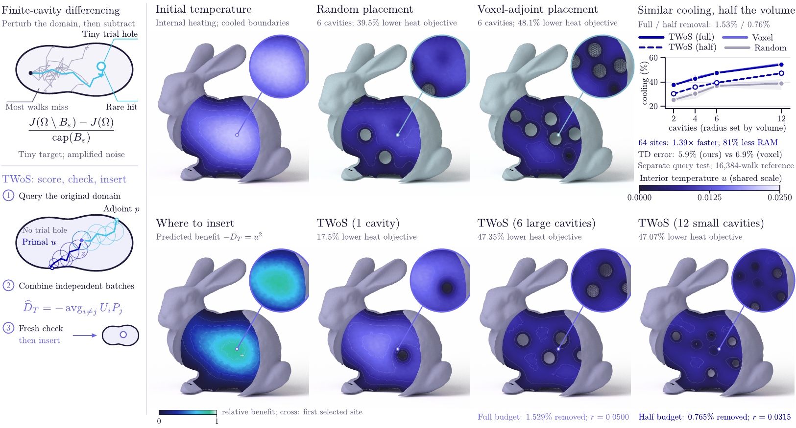

# Walking into Holes: Monte Carlo Topological Derivatives for Grid-Free PDE-Constrained Design

Johannes Herter, ETH Zürich, 2026. Paper: <https://johannesherter.com/papers/Walking_into_Holes_SIGGRAPH.pdf>



Deciding where a new hole should appear in a part is a different question from moving a surface that already exists.
Topological Walk on Spheres (TWoS) estimates the classical topological derivative, the first-order benefit of inserting
a small cavity, with local random walks on the current geometry, without a volumetric PDE discretization or a
shrinking trial hole. Cross-index products of primal and adjoint walks remove their correlation bias, the variance is
independent of the cavity radius, and validation with fresh samples decides whether a finite insertion is accepted.
This repository contains the paper source, every benchmark and experiment behind its figures and tables, and the
retained results.

## Requirements

- Python 3.10 or later with NumPy, SciPy, pandas and Matplotlib. The Bunny benchmarks also use libigl's Python
  bindings (`libigl`, tested with 2.6.3).
- For the compiled backends: CMake 3.18 or later, a C++17 compiler, Embree 4 and OpenMP. Each benchmark's README
  gives its build path.
- For the hero renders: the pinned packages in `figures/requirements-render.txt` (Mitsuba 3, trimesh, OIDN).
- For the paper: [Tectonic](https://tectonic-typesetting.github.io) (`latexmk -pdf` works too).

## Quick start

```bash
git clone https://github.com/hertjo/walking-into-holes.git
cd walking-into-holes
python -m venv .venv && source .venv/bin/activate
pip install numpy scipy pandas matplotlib libigl
make experiments      # controlled experiments: variance, correlation bias, adaptive selection (experiments/output/)
make paper            # paper/main.pdf
```

## Layout

| Path | Contents |
| --- | --- |
| `paper/` | LaTeX source of the paper: `main.tex`, `sections/`, `appendix/`, `tables/`, `figures/`, `references.bib` |
| `paper/figure-scripts/` | scripts that draw the paper figures from the tracked benchmark outputs |
| `experiments/` | seeded controlled experiments: capacity variance, correlation bias, adaptive selection, manufactured WoS fields |
| `benchmarks/` | one directory per study: code, protocol, results, audits and summary tables (each has a README) |
| `figures/` | path-traced Stanford Bunny renders used by the hero figure, and their render scripts |
| `video/` | the scripts and assets of the 82-second research video |

## Build the paper

```bash
make paper          # cd paper && tectonic main.tex   (latexmk -pdf main.tex works as well)
```

The appendix (complete proofs, protocols and expanded results) follows the bibliography in the same document.

## Reproduce the figures and tables

Every number in the paper comes from the files under `benchmarks/*/output/` and `experiments/output/`, which are
tracked. Each study regenerates its results, summaries, LaTeX tables and its own diagnostic plots (Matplotlib) with the
command below. The C++ backends (Embree 4, OpenMP, Eigen) are built by the listed targets; the README in each benchmark
directory gives dependencies and build paths. Per-run traces of some studies are large and are not tracked
(`benchmarks/*/output/*/`); the commands regenerate them.

| Paper figure or table | Command | Output |
| --- | --- | --- |
| Hero: Bunny cavity designs, count/volume study, 64-site query test | `make bunny-reference`, `make bunny-budget`, `make compiled-bunny`; renders `make hero-renders` | `benchmarks/{stanford_bunny,bunny_budget,compiled_bunny}/output/`, `figures/hero-assets/` |
| Actual-geometry estimators, matched pipelines, geometries, accessible channels; pipeline tables | `make submission-study` | `benchmarks/submission_study/output/` |
| Matched-accuracy sparse queries and fresh-seed confirmation | `python3 benchmarks/matched_accuracy/build.py`, then `python3 benchmarks/matched_accuracy/run.py` | `benchmarks/matched_accuracy/output/` |
| Controlled experiments, manufactured field | `make experiments` | `experiments/output/` |
| Minimum-benefit check on the unit ball | `python3 experiments/verify_minimum_benefit.py` | `experiments/output/minimum-benefit-*` |
| Application minimum-benefit validation | `make application-validation` | `benchmarks/minimum_benefit/output/` |
| Regional protection with a distinct adjoint (figure, tables) | `make distinct-adjoint` | `benchmarks/distinct_adjoint/output/` |
| Accessible ball-union channels (figure, tables) | see `benchmarks/accessible_channels/README.md` | `benchmarks/accessible_channels/output/` |
| Cavity count, volume and compliance | `make bunny-budget` | `benchmarks/bunny_budget/output/` |
| Analytic-geometry internal cooling | `make cooling-reference` | `benchmarks/internal_cooling/output/` |
| Stanford Bunny stress test | `make bunny-reference` | `benchmarks/stanford_bunny/output/` |
| Compiled Bunny scaling | `make compiled-bunny` | `benchmarks/compiled_bunny/output/` |
| Engineering housing: benchmark, trade-offs | `make engineering-housing` | `benchmarks/engineering_housing/output/` |
| Engineering housing: connected channel, offset sweep, external FEM audit | `make engineering-channels`, `make engineering-offset-sweep`, `make engineering-fem-audit` | `benchmarks/engineering_housing/output/{channels,external_fem}/` |
| Accelerated sampling and baseline components | `make critical-baselines` | `benchmarks/critical_baselines/output/` |
| Exact three-dimensional finite-cavity check | `python3 benchmarks/exact_cavity_audit/audit.py` | `benchmarks/exact_cavity_audit/` |

### Paper figures

The vector PDFs in `paper/figures/` are committed, so neither the paper build nor the benchmarks depend on the figure
scripts. The scripts in `paper/figure-scripts/` read the tracked outputs above and redraw each figure
(`f_*.py` for the main text, `s_*.py` for the appendix; `make paper-figures`). They were drawn with Splinx, the
author's figure tool, not public yet. `prep_*.py` prepare their inputs: recoloured copies of the tracked renders and
plane fields recomputed exactly as the benchmark scripts compute them (the Bunny scripts need libigl 2.6.3, the FEM
audit scikit-fem 11.0.0). For the connected channel, the offset sweep and two timing values of the FEM audit the
per-run folders were not retained; `paper/figure-scripts/data/` holds the values read back from an earlier build of
the paper (`recover/`); the read-back reproduces the correlation and slope stated in the paper.

## Citation

```bibtex
@article{herter2026walking,
  title  = {Walking into Holes: Monte Carlo Topological Derivatives for Grid-Free PDE-Constrained Design},
  author = {Herter, Johannes},
  note   = {ETH Z{\"u}rich},
  year   = {2026},
  url    = {https://johannesherter.com/papers/Walking_into_Holes_SIGGRAPH.pdf}
}
```

## License

The code is released under the MIT License (see `LICENSE`). The Stanford Bunny comes from the Stanford 3D Scanning
Repository; see `benchmarks/stanford_bunny/README.md` for its terms.
